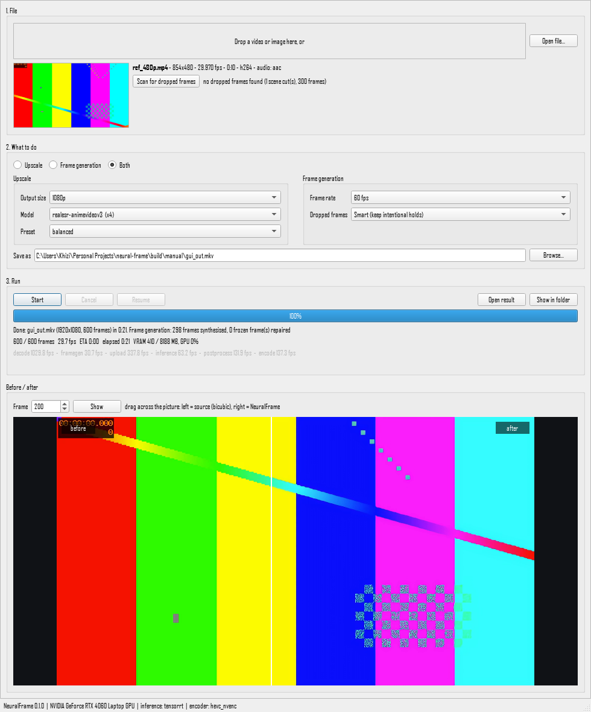

# NeuralFrame

Local, GPU-accelerated video and image super-resolution with frame generation. NeuralFrame takes a video
(or an image), upscales it with Real-ESRGAN-family models through TensorRT, ONNX Runtime or PyTorch,
optionally generates frames up to a constant frame rate with RIFE (repairing dropped and frozen frames on
the way), and writes a file with the original audio, subtitles and chapters intact and in sync. Everything
runs on your own computer; nothing is uploaded anywhere.

* **Upscaling** to 4K by default (or 8K, 1440p, 1080p, 2x/3x/4x, any width x height), aspect ratio kept.
* **Frame generation** to 60 fps by default (or any rate), with smart repair of dropped and frozen frames
  and no blending across scene cuts.
* **Fast**: TensorRT FP16 engines, CUDA-stream overlap, NVDEC/NVENC hardware video, a C++ module for
  CPU-side pixel work. 480p -> 1080p with `realesr-animevideov3` runs faster than real time on an 8 GB
  laptop GPU.
* **Robust**: VRAM calibration and an out-of-memory recovery ladder, scene-aware chunking with
  cancel/resume that reproduces identical frames, verified audio/video sync, exact colour handling.
* **Three ways to drive it**: a desktop app, a command line, and a local web interface with a job queue.



## Contents

1. [Which way should I use it?](#1-which-way-should-i-use-it)
2. [The Windows app (no programming needed)](#2-the-windows-app-no-programming-needed)
3. [Install from source on Windows](#3-install-from-source-on-windows)
4. [Install from source on Linux](#4-install-from-source-on-linux)
5. [Using NeuralFrame](#5-using-neuralframe) - desktop app, command line, web interface, configuration
6. [Build the Windows app yourself](#6-build-the-windows-app-yourself)
7. [Docker](#7-docker)
8. [Supported hardware](#8-supported-hardware) - [Performance](#9-performance) -
   [Troubleshooting](#10-troubleshooting) - [Limitations](#11-assumptions--limitations) -
   [Development](#12-development)

More: [How it works](docs/ARCHITECTURE.md) - [Benchmarks](docs/BENCHMARKS.md) -
[Before/after gallery](docs/GALLERY.md) - [Model cards](MODEL_CARDS.md) - [Roadmap and findings](docs/PLAN.md)

---

## 1. Which way should I use it?

| You want to... | Use | Section |
|---|---|---|
| Just upscale your videos on a Windows PC, no programming | the **Windows app** (a folder with `NeuralFrame.exe`) | [2](#2-the-windows-app-no-programming-needed) |
| Use the command line or change the code, on Windows | **install from source** | [3](#3-install-from-source-on-windows) |
| Run it on a Linux PC | **install from source** | [4](#4-install-from-source-on-linux) |
| Make the Windows app (to use it or give it to others) | **build the Windows app** | [6](#6-build-the-windows-app-yourself) |
| Run it on a Linux GPU server, or as an always-on service with a web page | **Docker** | [7](#7-docker) |

On Windows the native app or a source install is the best choice: Docker works there too but runs about
three times slower (see [section 7](#7-docker)).

**Hardware:** an NVIDIA GeForce RTX graphics card (RTX 20-series or newer) is strongly recommended. Without
one NeuralFrame still works on the processor, but neural upscaling becomes very slow (about 0.5 frames per
second). Other GPUs: see [Supported hardware](#8-supported-hardware).

---

## 2. The Windows app (no programming needed)

The Windows app is a folder containing `NeuralFrame.exe` (the desktop app) together with everything it
needs: Python, PyTorch, TensorRT, FFmpeg and the AI models. Nothing else has to be installed and it works
offline.

### What you need

* Windows 10 (version 1809 or newer) or Windows 11, 64-bit.
* About 10 GB of free disk space while unzipping (the 3.7 GB zip plus the 5.3 GB folder; the zip can be
  deleted afterwards), plus room for your videos (4K files are large).
* Recommended: an NVIDIA GeForce RTX 20-series or newer card with an up-to-date driver (version 580 or
  newer; install it from <https://www.nvidia.com/drivers> or the NVIDIA App).

### Get the app

The app is about 3.7 GB zipped, which is larger than GitHub allows for a single download file, so it is
not attached to the GitHub releases. Either:

* **build it yourself** by following [section 6](#6-build-the-windows-app-yourself) (one command once the
  development setup is installed), or
* get the file `NeuralFrame-<version>-win64-portable.zip` from whoever built it.

### Install it

1. Right-click `NeuralFrame-<version>-win64-portable.zip` and choose **Extract All...**. Pick a folder
   (for example `C:\Programs`) and click **Extract**. Extracting takes a few minutes.
   Do not run the program from inside the zip file: Windows only extracts that one file and it fails.
2. Open the extracted folder `NeuralFrame-<version>-win64`.
3. Double-click **NeuralFrame.exe**. Tip: right-click it and choose **Show more options -> Send to ->
   Desktop (create shortcut)** to start it from the desktop next time.
4. If Windows shows "Windows protected your PC", click **More info**, then **Run anyway**. The program is
   not signed with a paid certificate; the warning does not mean it is harmful.

How to use it is described in [5.1 The desktop app](#51-the-desktop-app). The folder also contains
`README.txt` (a short guide for non-technical users), `neuralframe-cli.exe` (the command-line version) and
`Command line.cmd` (opens a command prompt in that folder).

To remove the app, delete the folder. NeuralFrame also keeps optimised models, temporary files and logs in
`%LOCALAPPDATA%\neuralframe` (paste that into the Explorer address bar); delete it too to free that space.

---

## 3. Install from source on Windows

Use this to run NeuralFrame from the command line, to change the code, or as the first step for building
the Windows app yourself. It takes 20-40 minutes, mostly downloads, and needs about 15 GB of free disk space.

### Step 1: install the prerequisites

Open **PowerShell** (press the Windows key, type `PowerShell`, press Enter) and run these commands one at a
time. `winget` is built into Windows 10/11; accept the prompts it shows.

| What | Command | Why |
|---|---|---|
| NVIDIA driver (580 or newer) | install from <https://www.nvidia.com/drivers> or the NVIDIA App | GPU acceleration |
| Python 3.12 | `winget install Python.Python.3.12` | runs NeuralFrame (3.11 also works) |
| Git | `winget install Git.Git` | downloads the code |
| C++ build tools | `winget install Microsoft.VisualStudio.2022.BuildTools --override "--quiet --wait --add Microsoft.VisualStudio.Workload.VCTools --includeRecommended"` | compiles NeuralFrame's C++ module |
| FFmpeg | `winget install Gyan.FFmpeg` | reads and writes video (this build includes NVIDIA's hardware encoder) |

Instead of the build-tools command you can download **Build Tools for Visual Studio** from
<https://visualstudio.microsoft.com/visual-cpp-build-tools/> and tick **Desktop development with C++**;
an existing Visual Studio 2022 or newer with that workload works too.

**Close PowerShell and open a new window** so it finds the newly installed programs, then check:

```powershell
python --version      # Python 3.12.x
git --version
ffmpeg -version       # first line: ffmpeg version ...
nvidia-smi            # shows your graphics card and driver version (NVIDIA only)
```

If `python` opens the Microsoft Store instead, use `py -3.12` in place of `python` below, or turn off
*Settings -> Apps -> Advanced app settings -> App execution aliases -> python.exe*.

### Step 2: download the code

Choose a folder for it (here your Documents folder) and download:

```powershell
cd $HOME\Documents
git clone https://github.com/KhizirFarrukh/neural-frame.git
cd neural-frame
```

### Step 3: create a virtual environment

A virtual environment keeps NeuralFrame's Python packages separate from anything else on your PC.

```powershell
python -m venv .venv
.venv\Scripts\Activate.ps1
```

Your prompt now starts with `(.venv)`. If PowerShell says *running scripts is disabled on this system*,
run `Set-ExecutionPolicy -Scope CurrentUser RemoteSigned` once (answer `Y`) and try again. In the classic
Command Prompt use `.venv\Scripts\activate.bat` instead.

### Step 4: install PyTorch

With an NVIDIA card (about 2.5 GB download):

```powershell
python -m pip install --upgrade pip
pip install torch --index-url https://download.pytorch.org/whl/cu130
```

Without an NVIDIA card use `--index-url https://download.pytorch.org/whl/cpu` instead.

### Step 5: install NeuralFrame

```powershell
pip install -e ".[tensorrt,gui]"
```

This compiles the C++ module (a minute or two) and installs TensorRT (about 2 GB) and the desktop app's
Qt library. Pick the parts you need:

| Extra | What it adds |
|---|---|
| `tensorrt` | TensorRT, the fastest way to run the models on NVIDIA cards (leave it out on other hardware) |
| `gui` | the desktop app |
| `onnx-gpu` / `onnx` / `onnx-directml` | ONNX Runtime for NVIDIA / CPU / AMD and Intel GPUs on Windows |
| `release` | PyInstaller, needed to [build the Windows app](#6-build-the-windows-app-yourself) |
| `lpips` | an extra image-quality metric for `benchmarks/quality.py` |
| `dev` | tests and code checkers |

Combine them with commas, e.g. `pip install -e ".[tensorrt,gui,release]"`.

### Step 6: check the installation

```powershell
neuralframe doctor
```

You should see your graphics card under *GPUs*, `tensorrt` as the inference backend and `hevc_nvenc`
(NVIDIA's hardware encoder) under *Will use*. Without an NVIDIA card the backend is `torch` or `onnxruntime`
and the encoders are software ones (`libx265`, `libx264`); that works, just slower.

### Step 7: use it

```powershell
neuralframe-gui                                         # the desktop app
neuralframe upscale "C:\Videos\clip.mp4" -o "C:\Videos\clip_4k.mkv"
```

Everything you can do is in [section 5](#5-using-neuralframe). The first time each model runs on your card
it is optimised for it ("building TensorRT engine", 1-4 minutes); later runs start straight away. The AI
models themselves (3-150 MB each) are downloaded automatically the first time they are used.

### Every time you come back

Open PowerShell, go to the folder and activate the environment again:

```powershell
cd $HOME\Documents\neural-frame
.venv\Scripts\Activate.ps1
```

### Updating

```powershell
cd $HOME\Documents\neural-frame
.venv\Scripts\Activate.ps1
git pull
pip install -e ".[tensorrt,gui]"      # rebuilds the C++ module if it changed
```

### Uninstalling

Delete the `neural-frame` folder and `%LOCALAPPDATA%\neuralframe` (models, optimised engines, temporary
files, logs). The prerequisites from step 1 can be removed in *Settings -> Apps*.

---

## 4. Install from source on Linux

Tested on Ubuntu 24.04 (the same steps the Docker image and the automated tests use); other distributions
need the equivalent packages.

### Step 1: prerequisites

```bash
sudo apt update
sudo apt install -y python3 python3-venv python3-dev build-essential git curl xz-utils \
                    libgl1 libegl1 libxkbcommon0 libfontconfig1 libdbus-1-3 libglib2.0-0  # last line: desktop app only
nvidia-smi          # checks the NVIDIA driver (install it with: sudo ubuntu-drivers install, then reboot)
```

FFmpeg 9 (Ubuntu's own FFmpeg is older; NeuralFrame is developed against 9.0). A static build with
NVIDIA hardware video support:

```bash
mkdir -p ~/.local/ffmpeg
curl -fL https://github.com/BtbN/FFmpeg-Builds/releases/download/latest/ffmpeg-n9.0-latest-linux64-gpl-9.0.tar.xz \
  | tar -xJ -C ~/.local/ffmpeg --strip-components=1
echo 'export PATH="$HOME/.local/ffmpeg/bin:$PATH"' >> ~/.bashrc && source ~/.bashrc
ffmpeg -version | head -1
```

### Step 2: download, set up and install

```bash
cd ~
git clone https://github.com/KhizirFarrukh/neural-frame.git
cd neural-frame
python3 -m venv .venv
source .venv/bin/activate
python -m pip install --upgrade pip
pip install torch --index-url https://download.pytorch.org/whl/cu130   # no NVIDIA card: .../whl/cpu
pip install -e ".[tensorrt,gui]"                                        # no NVIDIA card: ".[gui]"
neuralframe doctor
```

Then continue with [section 5](#5-using-neuralframe). Next time: `cd ~/neural-frame && source
.venv/bin/activate`. Update with `git pull && pip install -e ".[tensorrt,gui]"`.

---

## 5. Using NeuralFrame

### 5.1 The desktop app

Start it with `NeuralFrame.exe` (Windows app) or `neuralframe-gui` (source install). You can also pass a
file: `neuralframe-gui "C:\Videos\clip.mp4"`.

1. **Choose a file.** Drag a video or picture onto the window, or click **Open file...**. The app shows
   a thumbnail, the size, frame rate, length, video codec and audio tracks.
2. **Optional: scan for dropped frames** (videos). **Scan for dropped frames** reports frozen frames and
   timestamp gaps (stutter) that frame generation will repair, plus scene cuts and intentional holds
   (cartoons animated "on twos" keep their style).
3. **Choose what to do:**
   * **Upscale** - bigger and sharper.
   * **Frame generation** - smoother motion at a constant frame rate, repairing stutter.
   * **Both** - both at once. Pictures can only be upscaled.
4. **Upscale settings:**
   * **Output size** - *4K* by default; *8K*, *1440p*, *1080p*, *720p*, *2x/3x/4x*, or *Custom...*
     where you type `2560x1440` (exact size), `x1.5` (scale factor) or `1200p` (height). The aspect ratio
     is kept unless you type an exact size.
   * **Model** - *Automatic* uses the preset's model. Otherwise:
     `realesr-animevideov3` (fast, ideal for cartoons and anime, good general choice),
     `realesrgan-x4plus` (most detail on real video and photos, slow), `realesrgan-x2plus` (2x, for
     degraded sources), `realbasicvsr-x4` (temporal model for noisy real-world video), `lanczos` /
     `bicubic` (plain resizing, very fast). See [MODEL_CARDS.md](MODEL_CARDS.md).
   * **Preset** - *quality*, *balanced* (default) or *fast*: model choice, tile overlap and how hard the
     video encoder works.
5. **Frame generation settings:**
   * **Frame rate** - 60 fps by default (59.94 for videos recorded at 29.97); 24, 30, 48, 120 or
     *Custom...* (e.g. `50`, `59.94`, `24000/1001`).
   * **Dropped frames** - *Smart* repairs stutter but keeps intentional holds, *Repair every repeated
     frame*, or *Off*.
6. **Save as** - by default next to the original, named after what was done (`clip_upscaled_60fps.mkv`;
   pictures keep their format). **Browse...** chooses another place. Videos are saved as `.mkv`, which keeps
   every audio and subtitle track; `.mp4` also works when you type it.
7. Press **Start**. The progress bar shows percent, frames, speed (fps), time remaining, graphics memory
   and how busy the GPU is, plus the speed of each processing stage. While the model is being prepared the
   bar animates without a percentage: the first run of a model on your card takes 1-4 minutes.
8. **Cancel** stops after the current frames; finished parts are kept and **Resume** continues from there
   while the app stays open. If you close the app (or the PC shuts down) in the middle of a job, starting
   it again in the app begins from the start. The command line can continue such a job: run it with
   `--resume` and exactly the same input file, output file and settings as in the app (see
   [5.2](#52-the-command-line)); if anything differs, it starts over.
9. When it is done: **Open result**, **Show in folder**, and the **Before / after** panel: drag across
   the picture to compare the original (left, scaled the ordinary way) with NeuralFrame (right). Enter a
   frame number and click **Show** to compare another frame.

Problems are shown in red with a hint. A detailed log is kept in
`%LOCALAPPDATA%\neuralframe\logs\neuralframe-gui.log` (Windows app).

### 5.2 The command line

In the Windows app folder the command is `neuralframe-cli.exe` (double-click `Command line.cmd` to get a
prompt there); in a source install it is `neuralframe` (with the virtual environment activated). Put file
names with spaces in quotes.

```bash
# Upscale to 4K (the default size) with the default ("balanced") preset
neuralframe upscale clip.mp4 -o clip_4k.mkv

# Pick the size: --target 1080p | 1440p | 4k | 8k | x2 | 2560x1440, or --scale 1.5, --target-height 1200
neuralframe upscale anime.mkv -o anime_1080p.mkv -m realesr-animevideov3 --target 1080p

# The project's reference case: best detail, quality preset
neuralframe upscale ref_480p.mp4 -o ref_1080p.mkv --model realesrgan-x4plus --target-height 1080 --preset quality

# Upscale and generate frames to 60 fps (--fps takes any rate: 50, 59.94, 120, 24000/1001)
neuralframe upscale clip.mp4 -o clip_4k60.mkv --fps 60

# Frame generation only (keeps the size), repairing stutter
neuralframe interpolate stuttery.mp4 -o smooth.mkv --fps 60 --repair-drops auto

# Pictures (PNG, JPEG, WebP, TIFF, BMP; 16-bit PNG and transparency are kept)
neuralframe upscale photo.jpg -o photo_4k.png -m realesrgan-x4plus

# Continue an interrupted job (Ctrl+C, crash, power cut): the same command plus --resume
neuralframe upscale clip.mp4 -o clip_4k.mkv --resume

# Information and tools
neuralframe doctor                       # graphics card, drivers, what will be used
neuralframe probe clip.mp4 --frames      # what NeuralFrame sees in a file
neuralframe models list                  # available models and licences
neuralframe models download realesrgan-x4plus   # download ahead of time (otherwise on first use)
neuralframe compare clip.mp4 clip_4k.mkv --frame 120 --crop 1600,800,640,360 --zoom 2   # side-by-side PNG
neuralframe benchmark -m realesr-animevideov3 -r 480p -t 1080p -n 300   # speed test
neuralframe --help                       # all commands;  neuralframe upscale --help  for all options
```

Useful `upscale` options:

| Option | Meaning |
|---|---|
| `-m`, `--model` | model id (see `neuralframe models list`) |
| `-t`, `--target` / `--scale` / `--target-height` / `--size` | output size (one of them) |
| `-p`, `--preset` | `quality`, `balanced` (default), `fast` |
| `--fps`, `--interpolate`, `--no-upscale` | frame generation (to a rate / at 60 fps / without upscaling) |
| `--codec hevc\|h264\|av1`, `--crf N` / `--cq N`, `--10bit` | output video format and quality (lower number = better quality, bigger file) |
| `--encoder` | force an encoder, e.g. `libx265` (software) or `hevc_nvenc` (NVIDIA) |
| `--backend auto\|tensorrt\|onnxruntime\|torch` | how the model runs (`auto` picks the fastest available) |
| `--max-vram-gb N` | leave graphics memory for other programs |
| `--deinterlace auto\|on\|off`, `--denoise light\|medium\|strong` | clean-up before upscaling |
| `-y`, `--overwrite` / `--resume` | replace an existing output / continue an interrupted job |

Every job writes `<output name>.report.json` next to the result: what was decided and why, timings,
per-stage speed, graphics memory, frame generation statistics and the audio/video sync check.

### 5.3 The web interface and job queue

```bash
neuralframe serve        # then open http://127.0.0.1:8765 in your browser
```

The page works like the desktop app: drop a file (it is uploaded to NeuralFrame's own folder) or type the
path of a file on this computer, choose Upscale / Frame generation / Both, watch the progress, cancel or
resume, download the result and compare before/after. Jobs run one at a time per GPU in a queue that
survives restarts. Stop the server with **Ctrl+C** (running jobs pause and continue at the next start).

From another terminal you can queue jobs on the running server:

```bash
neuralframe queue add clip.mp4 --fps 60      # prints the job id
neuralframe queue list
neuralframe queue watch <id>                 # live progress
neuralframe queue cancel <id>    /    neuralframe queue resume <id>
```

The server only accepts files inside your home folder (configurable, see `api.input_roots` and
`api.output_roots` in [config.example.yaml](config.example.yaml)) and only listens on this computer: it has
no passwords, so do not expose it to a network. Programs can use its REST API:

| Method | Path | |
|---|---|---|
| POST | `/v1/jobs` | create a job: `{"input": "...", "output": "...", "target": "4k", "options": {...}}` |
| GET | `/v1/jobs`, `/v1/jobs/{id}` | status, progress %, ETA, per-stage fps, VRAM, errors |
| GET | `/v1/jobs/{id}/events` | live progress (Server-Sent Events) |
| POST | `/v1/jobs/{id}/cancel`, `/v1/jobs/{id}/resume` | cancel keeping finished parts / continue |
| GET | `/v1/jobs/{id}/preview?frame=N&side=before\|after\|both` | before/after PNG |
| GET | `/v1/jobs/{id}/report`, `/v1/jobs/{id}/output` | job report / download the result |
| POST | `/v1/uploads`, `/v1/probe` | upload a file / inspect a file |
| GET | `/v1/models`, `/v1/system` | models and licences / system check (`doctor`) |

Interactive API documentation: <http://127.0.0.1:8765/docs> while the server runs.

### 5.4 Configuration

Defaults work for most people. To change them, copy [config.example.yaml](config.example.yaml) (every
option is explained there), keep only the lines you want to change, and save it where NeuralFrame looks
for it. The first one found is used:

1. the file given with `--config my.yaml` (works for every command, also `neuralframe-gui --config my.yaml`);
2. the file named in the environment variable `NEURALFRAME_CONFIG`;
3. `config.yaml` in the folder you run the command from;
4. your personal settings file: `%APPDATA%\neuralframe\config.yaml` on Windows (also used by the Windows
   app; paste `%APPDATA%` into the Explorer address bar and create the `neuralframe` folder) or
   `~/.config/neuralframe/config.yaml` on Linux.

Single settings can also be set with environment variables `NEURALFRAME_<SECTION>__<KEY>`
(e.g. `NEURALFRAME_INFERENCE__BACKEND=torch`); command-line options win over everything. The most useful
settings:

| Setting | Default | |
|---|---|---|
| `paths.cache_dir` | `%LOCALAPPDATA%\neuralframe` (Windows), `~/.cache/neuralframe` (Linux) | models, optimised engines, temporary files |
| `inference.backend`, `precision` | `auto`, `fp16` | TensorRT on NVIDIA, ONNX Runtime elsewhere |
| `vram.safety_margin`, `max_vram_gb` | 0.15, none | graphics memory left for other programs |
| `encode.encoder`, `codec`, `quality` | auto, hevc, per preset | hardware encoder first, software fallback |
| `chunking.chunk_frames` | 240 | how often progress is saved for resuming |
| `framegen.fps`, `order`, `repair_drops` | 60, auto, auto | frame generation defaults |
| `presets.<name>` | quality / balanced / fast | model, tile overlap, encoder speed and quality |

---

## 6. Build the Windows app yourself

This produces the folder and zip described in [section 2](#2-the-windows-app-no-programming-needed), to
use yourself or to give to people who do not program.

### What you need

* A Windows PC with the source installation from [section 3](#3-install-from-source-on-windows), including
  the `tensorrt` and `gui` extras, plus `release`.
* About 25 GB of free disk space (the build, the finished 5.3 GB folder and the 3.7 GB zip).
* 15-30 minutes. An NVIDIA card is needed for the full self-test; on a PC without one, install the CPU
  version of PyTorch (section 3, step 4), leave out the `tensorrt` extra and build with
  `--no-tensorrt` (the self-test then skips the GPU checks).

### Steps

```powershell
cd $HOME\Documents\neural-frame
.venv\Scripts\Activate.ps1
pip install -e ".[tensorrt,gui,release]"
python packaging\windows\build_release.py --zip
```

The script:

1. checks the environment (PyTorch with CUDA, TensorRT, PySide6, the C++ module, PyInstaller);
2. packages the app with PyInstaller into one folder with `NeuralFrame.exe` (desktop app) and
   `neuralframe-cli.exe` (command line);
3. downloads FFmpeg 9 (checksum-verified) into it and copies the AI models into it, so it works offline;
4. removes files only needed for building (about 0.9 GB);
5. **tests the result the way a user runs it**: from a fresh, empty data folder and with nothing from your
   development setup available, it runs a simple upscale, an upscale with TensorRT (building the engine
   inside the package), frame generation, and starts the desktop app; the build stops with an error if any
   of this fails;
6. creates the zip and `SHA256SUMS.txt`.

### What you get (in `build\release\`)

| File | |
|---|---|
| `NeuralFrame-<version>-win64\` | the app folder (5.3 GB); double-click `NeuralFrame.exe` to use it right away |
| `NeuralFrame-<version>-win64-portable.zip` | the same folder zipped (3.7 GB) to copy or share |
| `SHA256SUMS.txt` | checksums so others can verify the download |
| `NeuralFrame-<version>-win64-smoke-test.json` | the self-test results |

### Sharing it

Give people the zip together with the steps in [Install it](#install-it). GitHub limits release files to
2 GB, so for the 3.7 GB zip use a file-sharing service (OneDrive, Google Drive, Dropbox...) or split it
with 7-Zip into parts smaller than 2 GB (people then need 7-Zip to join them). A smaller build without
TensorRT (`--no-tensorrt`, about 2 GB smaller, NVIDIA cards run 1.3-2.6x slower) fits more easily.

### Options

| Option | Effect |
|---|---|
| `--zip` | also create the portable zip |
| `--no-tensorrt` | leave TensorRT out (smaller; the app then uses PyTorch on NVIDIA cards) |
| `--trt-archs all` | keep TensorRT support for datacenter GPUs too (A100/H100/B200, +0.9 GB) |
| `--with-onnxruntime` | also include ONNX Runtime (not needed on NVIDIA) |
| `--no-models` | do not include the models (downloaded on first use instead; needs internet) |
| `--skip-tests` | skip the self-test (not recommended) |
| `--out FOLDER` | write somewhere other than `build\release` |

### Optional: an installer (Setup.exe)

If [Inno Setup 6](https://jrsoftware.org/isinfo.php) is installed (`winget install JRSoftware.InnoSetup`),
the same command also creates `NeuralFrame-<version>-win64-Setup.exe`: a normal Windows installer that
needs no administrator rights, adds Start-menu (and optionally desktop) shortcuts, a "NeuralFrame command
line" shortcut and an uninstaller in *Settings -> Apps*. Because the app is larger than 2 GB, the installer
comes as `Setup.exe` plus `Setup-1.bin`, `Setup-2.bin`...; keep them in the same folder. Note: the
installer script (`packaging\windows\neuralframe.iss`) has not been tried on the development machine yet
(Inno Setup was not installed there), unlike the portable zip, which is built and tested by every run.

---

## 7. Docker

A Docker image packages NeuralFrame together with its own Linux system, Python, PyTorch, TensorRT and
FFmpeg, so it runs the same way on any machine with Docker and an NVIDIA card. It is mainly meant for
**Linux servers** (for example a rented cloud GPU) and for running NeuralFrame as an always-on service with
its web page. On a Windows PC prefer the Windows app or a source install: Docker Desktop runs containers in
a virtual machine and was about three times slower in our test (11.9 instead of 35 frames per second).

The image is built from this repository's `Dockerfile` (there is no pre-built image to download). Building
downloads about 8 GB, takes 15-30 minutes the first time and needs about 25 GB of disk space; the finished
image is about 19 GB.

### Step 1: install Docker with GPU support

**Windows:**

1. Install the NVIDIA driver (580 or newer).
2. Install **Docker Desktop**: `winget install Docker.DockerDesktop` or from
   <https://www.docker.com/products/docker-desktop/>; keep the default *Use WSL 2* setting. Restart the PC
   when asked, then start Docker Desktop once and wait until it says *Engine running*.
3. GPU support needs no extra software on Windows. To check it, run the test from Docker's documentation
   in PowerShell: `docker run --rm -it --gpus=all nvcr.io/nvidia/k8s/cuda-sample:nbody nbody -gpu -benchmark`
   should name your graphics card and print a benchmark result. (After building the image in step 2 you can
   also run `docker run --rm --gpus all neuralframe doctor`.)

Docker Desktop's virtual machine gets half of your RAM by default; if the build fails with out-of-memory
errors, close other programs (in particular do not run GPU jobs at the same time).

**Linux (Ubuntu):**

```bash
# Docker Engine (official convenience script; see https://docs.docker.com/engine/install/ for alternatives)
curl -fsSL https://get.docker.com | sudo sh
sudo usermod -aG docker $USER          # then log out and back in, so docker works without sudo

# NVIDIA Container Toolkit (lets containers use the GPU; current steps:
# https://docs.nvidia.com/datacenter/cloud-native/container-toolkit/latest/install-guide.html)
curl -fsSL https://nvidia.github.io/libnvidia-container/gpgkey \
  | sudo gpg --dearmor -o /usr/share/keyrings/nvidia-container-toolkit-keyring.gpg
curl -fsSL https://nvidia.github.io/libnvidia-container/stable/deb/nvidia-container-toolkit.list \
  | sed 's#deb https://#deb [signed-by=/usr/share/keyrings/nvidia-container-toolkit-keyring.gpg] https://#g' \
  | sudo tee /etc/apt/sources.list.d/nvidia-container-toolkit.list
sudo apt update && sudo apt install -y nvidia-container-toolkit
sudo nvidia-ctk runtime configure --runtime=docker
sudo systemctl restart docker

sudo docker run --rm --runtime=nvidia --gpus all ubuntu nvidia-smi   # should print your graphics card
```

### Step 2: get the code and build the image

```bash
git clone https://github.com/KhizirFarrukh/neural-frame.git
cd neural-frame
docker build -t neuralframe .
```

When it finishes, `docker images neuralframe` lists the image. The build verifies itself: it fails if the
C++ module cannot be imported. Check that the container sees your graphics card and NVIDIA's video
encoder:

```bash
docker run --rm --gpus all -e NVIDIA_DRIVER_CAPABILITIES=compute,utility,video neuralframe doctor
```

It should list your card under *GPUs*, `tensorrt` as the backend and `hevc_nvenc` under *Will use*. After
changing the code, run `docker build -t neuralframe .` again; it only redoes the steps after the change
(a few minutes).

### Step 3a: run the web interface (docker compose)

```bash
mkdir data                         # your videos go here (it appears as /data inside the container)
docker compose up -d               # starts in the background (builds the image first if needed)
```

Open <http://127.0.0.1:8765>. Two ways to work with files:

* **Drag a file onto the page** - it is uploaded into the container; when the job is done use
  **Download result**.
* **Copy files into the `data` folder** and type their path *as the container sees it* into the page's
  path box, e.g. `/data/my video.mp4`. The result is written next to it, so it appears in your `data`
  folder.

Useful commands (run them in the `neural-frame` folder):

```bash
docker compose logs -f             # what the server is doing (Ctrl+C stops watching, not the server)
docker compose ps                  # is it running?
docker compose down                # stop it (models and optimised engines are kept)
docker compose up -d               # start it again
```

The web page is only reachable from this computer (`127.0.0.1` in `docker-compose.yml`), because the
service has no passwords.

### Step 3b: run one-off commands

Run the same commands as in [5.2](#52-the-command-line) through `docker run`, with your files in the
`data` folder:

```bash
# Linux / macOS shell
docker run --rm --gpus all -e NVIDIA_DRIVER_CAPABILITIES=compute,utility,video \
  -v "$PWD/data:/data" -v neuralframe-cache:/cache neuralframe \
  upscale /data/my_video.mp4 -o /data/my_video_4k.mkv
```

```powershell
# Windows PowerShell (one line)
docker run --rm --gpus all -e NVIDIA_DRIVER_CAPABILITIES=compute,utility,video -v "${PWD}\data:/data" -v neuralframe-cache:/cache neuralframe upscale /data/my_video.mp4 -o /data/my_video_4k.mkv
```

Replace everything after `neuralframe` with any command, e.g. `doctor` (check the GPU is found),
`interpolate /data/a.mp4 -o /data/a_60fps.mkv`, or `--help`. What the parts mean:

| Part | Meaning |
|---|---|
| `--rm` | delete the container when the command finishes (the image stays) |
| `--gpus all` | give the container the graphics card |
| `-e NVIDIA_DRIVER_CAPABILITIES=compute,utility,video` | also allow NVIDIA's hardware video encoder/decoder |
| `-v "$PWD/data:/data"` | your `data` folder appears as `/data` inside |
| `-v neuralframe-cache:/cache` | a Docker volume that keeps downloaded models and optimised engines between runs |

### Updating and removing

```bash
git pull && docker compose up -d --build         # update to the latest code and restart
docker compose down                              # stop
docker rmi neuralframe                           # delete the image (about 19 GB)
docker volume rm neuralframe-cache              # delete cached models and optimised engines
docker builder prune                             # delete the build cache
```

### Docker problems

* **`could not select device driver "" with capabilities: [[gpu]]`** - GPU support is missing: on Linux
  install the NVIDIA Container Toolkit (step 1) and restart Docker; on Windows update Docker Desktop and the
  NVIDIA driver.
* **`doctor` shows no `nvenc` encoders** - add `-e NVIDIA_DRIVER_CAPABILITIES=compute,utility,video` (the
  compose file already sets it).
* **Permission denied writing to `/data`** (Linux) - the container runs as user ID 1000; make the folder
  writable for it: `sudo chown 1000:1000 data`.
* **The Docker engine stops responding during the build** (Windows) - Docker Desktop ran out of memory;
  restart it (`docker desktop restart`) and build again with other programs closed.

---

## 8. Supported hardware

| Platform | Inference | Video decode / encode | Status |
|---|---|---|---|
| NVIDIA (RTX 20-series / Turing or newer recommended) | TensorRT FP16, ONNX Runtime CUDA, PyTorch CUDA | NVDEC / NVENC | tested (RTX 4060 Laptop, 8 GB, Windows 11) |
| AMD | ONNX Runtime DirectML (Windows) / ROCm (Linux) | AMF / VAAPI | implemented, untested (no hardware) |
| Intel | ONNX Runtime DirectML | QSV / VAAPI | implemented, untested (no hardware) |
| Apple | PyTorch / ONNX Runtime on the CPU | VideoToolbox | encoder mapping implemented, untested |
| CPU only | PyTorch / ONNX Runtime CPU, C++ ops | software (x264/x265/SVT-AV1) | tested (Windows and Linux) |

Several NVIDIA GPUs: one job runs per GPU from a shared queue (`--gpus 0,1`); tested with two workers on
one GPU.

## 9. Performance

Measured end to end (decode -> model -> encode, audio muxed) on an RTX 4060 Laptop GPU (8 GB); full
results, quality metrics and the optimisation log are in [docs/BENCHMARKS.md](docs/BENCHMARKS.md).

| | 480p -> 1080p | 720p -> 4K | 1080p -> 4K |
|---|---|---|---|
| Lanczos | 101.7 fps | 42.5 fps | 32.8 fps |
| realesr-animevideov3 (TensorRT) | 35.2 fps (faster than real time) | 10.5 fps | 8.6 fps |
| realesrgan-x2plus (TensorRT) | 6.3 fps | - | 1.25 fps |
| realesrgan-x4plus (TensorRT) | 1.63 fps | 0.60 fps | 0.18 fps |
| + frame generation to 59.94 fps (animevideov3) | 29.4 output fps | | |

TensorRT is 2.3-2.8x faster than PyTorch end to end. On compressed 4x input the neural models add
18-32 VMAF points over bicubic; chunk and tile seams are invisible (seam ratio 1.01-1.07, tiled vs whole
frame > 55 dB). See the [gallery](docs/GALLERY.md) for crops.

## 10. Troubleshooting

* **`ffmpeg not found` (`TOOL_MISSING`)** - install FFmpeg (section 3 or 4, step 1) and open a new
  terminal, or set `ffmpeg.ffmpeg` / `ffmpeg.ffprobe` in a config file. `neuralframe doctor` shows which
  FFmpeg is used. (The Windows app has its own.)
* **`pip install -e .` fails while building the C++ module** - the C++ build tools are missing or were
  installed without *Desktop development with C++* (section 3, step 1); open a new terminal after
  installing them.
* **The first run of a model takes minutes** - TensorRT optimises the model for your card and the video
  size once (1-4 minutes); it is reused afterwards and redone only after a driver or TensorRT update.
  `--backend torch` skips it (slower processing).
* **Out of memory (`OOM_UNRECOVERABLE`) or the PC becomes sluggish** - NeuralFrame adapts on its own, but
  other programs may be using the graphics memory: close games and video editors, or use `--max-vram-gb 4`.
  For `realbasicvsr-x4` a smaller `--chunk-frames` (e.g. 32) also helps.
* **Hardware encoder errors** (NVENC session limits, unsupported sizes) - NeuralFrame tests the encoder
  first and falls back to the next one automatically (noted in the report). Force one with
  `--encoder libx265`.
* **`SYNC_CHECK_FAILED`** - the output did not match the input's frame count or duration within one frame;
  the report says what differs. Please report it with the report file and `neuralframe probe --frames`.
* **Colours look slightly different** - older SD videos are converted to the HD colour standard (BT.709)
  for HD output; HDR videos are kept as HDR (10-bit, no tone mapping). Players that ignore colour
  information can show small shifts.
* **Resume says the job changed** - resuming needs the same input file and settings; use `--overwrite` to
  start over.
* **The desktop app does not start (source install)** - install the extra: `pip install -e ".[gui]"`.

## 11. Assumptions & limitations

* Only one NVIDIA GPU was available for development: multi-GPU scheduling is tested with two workers on
  one GPU; AMD/Intel/Apple paths are implemented through ONNX Runtime providers and FFmpeg encoder mappings
  but not exercised on real hardware. Native Linux with an NVIDIA GPU was tested only inside Docker.
* No CUDA toolkit is required (or was available): GPU-side pixel work uses PyTorch rather than
  hand-written CUDA kernels; decoded frames reach the GPU through pinned host memory, not NVDEC zero-copy.
* GAN-based models invent plausible detail: they score below bicubic on PSNR while improving perceptual
  metrics (LPIPS, VMAF on degraded input). Choose the model for the content (see the model cards).
* RIFE runs in PyTorch FP16 (no TensorRT engine yet); it is the bottleneck when frame generation runs at
  4K output.
* Drop detection works on small thumbnails: a frozen frame is found when its surroundings move; drops in an
  almost static shot are left alone unless `repair_drops: on`.
* HDR is passed through without tone mapping; the models are trained on SDR content.
* The REST API has no authentication and listens on 127.0.0.1 only by default.
* TensorRT engines are specific to a GPU and video size; the first job at a new size builds one.
* The Windows app is not code-signed (SmartScreen warning) and is larger than GitHub's 2 GB release-file
  limit.
* The web UI ships inside the Python package (`neuralframe/api/static`) rather than a separate `web/`
  folder, so `pip install` includes it.

## 12. Development

```bash
pip install -e ".[dev,gui,onnx-gpu,tensorrt]"
ruff check neuralframe tests benchmarks packaging && mypy neuralframe
pytest                                   # GPU / network tests skip themselves when unavailable
cmake -S . -B build/native-tests -DNEURALFRAME_BUILD_TESTS=ON -DNEURALFRAME_BUILD_PYTHON=OFF
cmake --build build/native-tests --config Release && ctest --test-dir build/native-tests -C Release
python benchmarks/run.py                 # throughput matrix -> benchmarks/results/
python benchmarks/quality.py             # quality evaluation (downloads the CC BY Sintel trailer once)
```

Layout: `neuralframe/{cli,api,db,core,io,chunking,inference,models,ops,framegen,quality,gui}`, C++ in
`native/`, packaging in `packaging/windows/`, tests in `tests/` (unit and integration; test videos are
generated with FFmpeg at test time), the roadmap and findings per milestone in [docs/PLAN.md](docs/PLAN.md).
Continuous integration (`.github/workflows/ci.yml`) runs the checks and tests on the CPU path and the C++
tests on Linux and Windows.

## Credits

Models: Real-ESRGAN (BSD-3-Clause), RealBasicVSR (Apache-2.0), RIFE / Practical-RIFE (MIT); see
[MODEL_CARDS.md](MODEL_CARDS.md). Evaluation footage: *Sintel* trailer, (c) Blender Foundation |
durian.blender.org, CC BY 3.0. FFmpeg is a trademark of Fabrice Bellard.
