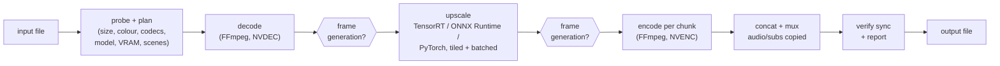

# NeuralFrame

Local, GPU-accelerated video and image super-resolution with frame generation. NeuralFrame takes a video
(or an image), upscales it with Real-ESRGAN-family models through TensorRT, ONNX Runtime or PyTorch,
optionally generates frames up to a constant frame rate with RIFE (repairing dropped and frozen frames on
the way), and writes a file with the original audio, subtitles and chapters intact and in sync.

* **Upscaling** to 4K by default (or 8K, 1440p, 1080p, 2x/3x/4x, any WxH), aspect ratio preserved.
* **Frame generation** to 60 fps by default (or any rate), with smart repair of dropped and frozen frames
  and no blending across scene cuts.
* **Fast**: TensorRT FP16 engines, CUDA-stream overlap, NVDEC/NVENC, a C++ module for CPU-side pixel
  work. 480p -> 1080p with `realesr-animevideov3` runs faster than real time on an 8 GB laptop GPU.
* **Robust**: VRAM calibration and an out-of-memory recovery ladder, scene-aware chunking with
  kill-and-resume that reproduces identical frames, verified A/V sync, exact colour handling.
* **Three front ends**: CLI, a local job service with REST API and web UI, and a desktop app.


## Contents

[Quick start](#quick-start) - [Usage](#usage) - [Configuration](#configuration) -
[Hardware](#supported-hardware) - [Performance](#performance) - [Troubleshooting](#troubleshooting) -
[Limitations](#assumptions--limitations) - [Development](#development) - [Architecture](docs/ARCHITECTURE.md)
- [Benchmarks](docs/BENCHMARKS.md) - [Gallery](docs/GALLERY.md) - [Model cards](MODEL_CARDS.md)

## How it works



Stages are threads joined by bounded queues; each chunk of frames is committed as its own segment, so an
interrupted job resumes where it stopped. Details: [docs/ARCHITECTURE.md](docs/ARCHITECTURE.md).

## Quick start

### Windows app (no installation of anything else)

1. Download `NeuralFrame-<version>-win64-portable.zip` from the releases page.
2. Right-click it, choose **Extract All...**, and open the extracted folder (do not run it from inside the zip).
3. Double-click **NeuralFrame.exe**. Drop a video or picture on the window, choose Upscale / Frame
   generation / Both, press Start.

Everything is included: Python, PyTorch (CUDA), TensorRT, FFmpeg and the AI models, so it works offline.
Requirements: Windows 10/11 64-bit; an NVIDIA GeForce RTX 20-series or newer GPU with driver 580+ is
recommended (it also runs on the CPU, slowly). Windows SmartScreen may warn because the program is not
code-signed: *More info -> Run anyway*. The folder also contains `neuralframe-cli.exe` (command line) and a
`README.txt` written for non-technical users.

### With Docker (NVIDIA GPU)

Requires Docker with the [NVIDIA Container Toolkit](https://docs.nvidia.com/datacenter/cloud-native/container-toolkit/).

```bash
mkdir -p data && cp my_video.mp4 data/
docker compose up -d                      # web UI + API on http://127.0.0.1:8765
# or one-off jobs:
docker run --rm --gpus all -e NVIDIA_DRIVER_CAPABILITIES=compute,utility,video \
  -v "$PWD/data:/data" -v neuralframe-cache:/cache neuralframe \
  upscale /data/my_video.mp4 -o /data/my_video_4k.mkv
```

The image bundles PyTorch (CUDA 13), TensorRT 10, ONNX Runtime and a static FFmpeg 9 with NVENC/NVDEC.
Models are downloaded into the cache volume on first use; TensorRT engines are built once per GPU/shape.
On Windows, Docker Desktop runs containers in a WSL2 VM with GPU paravirtualisation: everything works
(TensorRT, NVDEC, NVENC), but throughput was about a third of native in our test (encode-bound), so on
Windows prefer the native app; the image is aimed at Linux hosts.

### With pip

Needs Python 3.11 or 3.12, a C++17 compiler (MSVC 2022+, GCC 11+ or Clang 14+) and FFmpeg on `PATH`
(developed and tested with FFmpeg 9.0; NVENC/NVDEC are used when the build has them).

```bash
python -m venv .venv && . .venv/bin/activate          # Windows: .venv\Scripts\activate
pip install torch --index-url https://download.pytorch.org/whl/cu130   # or /whl/cpu
pip install -e ".[tensorrt,onnx-gpu,gui]"              # builds the native module
neuralframe doctor                                      # what will be used on this machine
```

Extras: `tensorrt` (CUDA 13; `tensorrt-cu12` for CUDA 12), `onnx` / `onnx-gpu` / `onnx-directml`,
`gui` (PySide6), `lpips` (perceptual metric), `dev` (tests and linters). Without PyTorch NeuralFrame still
runs the classical resamplers and the FFmpeg frame-generation fallback on the CPU.

## Usage

```bash
# The reference case: 480p -> 1080p with the general-purpose model, quality preset
neuralframe upscale ref_480p.mp4 -o ref_1080p.mkv --model realesrgan-x4plus --target-height 1080 --preset quality

# Default: 4K output, model from the preset ("balanced")
neuralframe upscale clip.mp4 -o clip_4k.mkv

# Other targets: --target 1440p | 8k | x2 | 2560x1440, --scale 1.5, --size 1920x1080
neuralframe upscale anime.mkv -o anime_1080p.mkv -m realesr-animevideov3 --target 1080p

# Upscale and generate frames to 60 fps (59.94 for NTSC sources); --fps takes any rate
neuralframe upscale clip.mp4 -o clip_4k60.mkv --fps 60

# Frame generation only (keeps the size), with dropped/frozen frame repair
neuralframe interpolate stuttery.mp4 -o smooth.mkv --fps 60 --repair-drops auto

# Images (PNG/JPEG/WebP/TIFF/BMP; 16-bit PNG and alpha preserved)
neuralframe upscale photo.jpg -o photo_4k.png -m realesrgan-x4plus

# Resume an interrupted job (Ctrl+C, crash, power loss): same command plus --resume
neuralframe upscale clip.mp4 -o clip_4k.mkv --resume

# Desktop app, job service + web UI, queue
neuralframe-gui                        # or: neuralframe gui [file]
neuralframe serve                      # http://127.0.0.1:8765
neuralframe queue add clip.mp4 --fps 60 && neuralframe queue list && neuralframe queue watch <id>

# Diagnostics and evaluation
neuralframe doctor                     # GPU, driver, CUDA/TensorRT/ORT, working hardware codecs
neuralframe probe clip.mp4 --frames    # what NeuralFrame sees in a file
neuralframe models list | download <id> | verify | export <id>
neuralframe benchmark -m realesr-animevideov3 -r 480p -t 1080p -n 300
neuralframe compare clip.mp4 clip_4k.mkv --frame 120 --crop 1600,800,640,360 --zoom 2
```

Useful `upscale` options: `--backend auto|tensorrt|onnxruntime|torch`, `--encoder auto|hevc_nvenc|libx265|...`,
`--codec hevc|h264|av1`, `--crf/--cq N`, `--10bit`, `--deinterlace auto|on|off`, `--denoise light|medium|strong`,
`--max-vram-gb N`, `--gpus 0,1`, `--tile-size N`, `--batch-size N`, `--chunk-frames N`,
`--framegen-order auto|upscale_first|interpolate_first`. `neuralframe upscale --help` lists everything.

Every job writes `<output>.report.json`: the plan (with the reasons for each decision), timings,
per-stage throughput and bottleneck, VRAM calibration, frame generation statistics and the sync check.

### REST API

`neuralframe serve` (or the Docker image) exposes, on 127.0.0.1 by default:

| Method | Path | |
|---|---|---|
| POST | `/v1/jobs` | create a job: `{"input": "...", "output": "...", "target": "4k", "options": {...JobSpec fields}}` |
| GET | `/v1/jobs`, `/v1/jobs/{id}` | status, progress %, ETA, per-stage fps, VRAM, errors |
| GET | `/v1/jobs/{id}/events` | Server-Sent Events progress stream |
| POST | `/v1/jobs/{id}/cancel`, `/v1/jobs/{id}/resume` | cancel keeping finished chunks / continue |
| GET | `/v1/jobs/{id}/preview?frame=N&side=before\|after\|both` | before/after PNG at the output size |
| GET | `/v1/jobs/{id}/report`, `/v1/jobs/{id}/output` | job report / download the result |
| POST | `/v1/uploads`, `/v1/probe` | upload a file / inspect a file |
| GET | `/v1/models`, `/v1/system` | models, built engines, licences / `doctor` as JSON |

Interactive documentation is served at `/docs`. File paths must lie inside `api.input_roots` /
`api.output_roots` (default: your home directory); the API has no authentication, so keep it local.

## Configuration

Settings come from (lowest to highest priority) built-in defaults, a YAML file (`--config`), environment
variables `NEURALFRAME_<SECTION>__<KEY>` (e.g. `NEURALFRAME_INFERENCE__BACKEND=torch`,
`NEURALFRAME_API__INPUT_ROOTS='["/data"]'`) and command-line options. Every option is documented in
[config.example.yaml](config.example.yaml). The most useful ones:

| Setting | Default | |
|---|---|---|
| `paths.cache_dir` | per-user cache | models, TensorRT engines, analysis cache, work files |
| `inference.backend` / `precision` | `auto` / `fp16` | TensorRT on NVIDIA, ONNX Runtime elsewhere |
| `inference.tile_size`, `batch_size` | auto | fixed by calibration unless set |
| `vram.safety_margin`, `max_vram_gb` | 0.15, none | keep VRAM free for other applications |
| `encode.encoder`, `codec`, `quality` | auto, hevc, per preset | hardware encoder first, software fallback |
| `chunking.chunk_frames` | 240 | resume granularity |
| `framegen.fps`, `order`, `repair_drops` | 60, auto, auto | frame generation defaults |
| `presets.<name>` | quality / balanced / fast | model, tile overlap, encoder speed and quality |

## Supported hardware

| Platform | Inference | Decode / encode | Status |
|---|---|---|---|
| NVIDIA (Turing or newer recommended) | TensorRT FP16, ONNX Runtime CUDA, PyTorch CUDA | NVDEC / NVENC | tested (RTX 4060 Laptop, 8 GB, Windows 11) |
| AMD | ONNX Runtime DirectML (Windows) / ROCm (Linux) | AMF / VAAPI | implemented, untested (no hardware) |
| Intel | ONNX Runtime DirectML / OpenVINO-capable builds | QSV / VAAPI | implemented, untested (no hardware) |
| Apple | PyTorch CPU / ONNX Runtime CPU | VideoToolbox | encoder mapping implemented, untested |
| CPU only | PyTorch / ONNX Runtime CPU, C++ ops | software (x264/x265/SVT-AV1) | tested (CI path) |

Multi-GPU: one worker per GPU pulling from a shared queue (`--gpus 0,1`); tested with two workers on one GPU.

## Performance

Measured end to end (decode -> model -> encode, audio muxed) on an RTX 4060 Laptop GPU (8 GB); full
results, quality metrics and the optimisation log are in [docs/BENCHMARKS.md](docs/BENCHMARKS.md).

| | 480p -> 1080p | 720p -> 4K | 1080p -> 4K |
|---|---|---|---|
| Lanczos | 101.7 fps | 42.5 fps | 32.8 fps |
| realesr-animevideov3 (TensorRT) | 35.2 fps (faster than real time) | 10.5 fps | 8.6 fps |
| realesrgan-x2plus (TensorRT) | 6.3 fps | - | 1.25 fps |
| realesrgan-x4plus (TensorRT) | 1.63 fps | 0.60 fps | 0.18 fps |
| + frame generation to 59.94 fps (animevideov3) | 29.4 output fps | | |

TensorRT is 2.3-2.8x faster than PyTorch end to end. On compressed 4x input the neural models add
18-32 VMAF points over bicubic; chunk and tile seams are invisible (seam ratio 1.01-1.07, tiled vs whole
frame > 55 dB). See the [gallery](docs/GALLERY.md) for crops.

## Troubleshooting

* **`TOOL_MISSING: ffmpeg not found`** - install FFmpeg and put it on `PATH`, or set `ffmpeg.ffmpeg` /
  `ffmpeg.ffprobe` in the config. `neuralframe doctor` shows which binary is used.
* **The first run of a model is slow** - TensorRT builds an engine for your GPU and frame size once
  (1-4 minutes on a laptop GPU); it is cached (`<cache>/engines`) and rebuilt only when the GPU, driver or
  TensorRT version changes. `--backend torch` skips the build.
* **Out of memory / the PC becomes sluggish** - NeuralFrame calibrates and shrinks tiles/batches itself;
  if other applications need VRAM, use `--max-vram-gb 4` or a larger `vram.safety_margin`. On Windows an
  overcommitted GPU silently spills into shared memory and slows everything down rather than failing.
* **Hardware encoder errors** (NVENC session limits, unsupported sizes) - a 2-frame preflight detects them
  and falls back to the next encoder (logged in the report). Force one with `--encoder libx265`.
* **`SYNC_CHECK_FAILED`** - the output did not match the input's frame count or duration within one
  frame; the report lists the problem. Please file it with the report and `neuralframe probe --frames`.
* **Colours look different** - SD sources are converted to BT.709 for HD output (matrix and primaries);
  tagged HDR is passed through as 10-bit without tone mapping. Players that ignore colour tags show shifts.
* **Resume says the job changed** - resuming needs the same input and settings (the manifest pins them);
  use `--overwrite` to start over.
* **GUI does not start** - install the extra: `pip install neuralframe[gui]`.

## Assumptions & limitations

* Only one NVIDIA GPU was available for development: multi-GPU scheduling is tested with two workers on
  one GPU; AMD/Intel/Apple paths are implemented through ONNX Runtime providers and FFmpeg encoder mappings
  but not exercised on real hardware.
* No CUDA toolkit is required (or was available): GPU-side pixel ops are PyTorch tensor ops rather than
  hand-written CUDA kernels; decoded frames reach the GPU through pinned host memory, not NVDEC zero-copy.
* GAN-based models invent plausible detail: they score below bicubic on PSNR while improving perceptual
  metrics (LPIPS, VMAF on degraded input). Choose the model for the content (see the model cards).
* RIFE runs in PyTorch FP16 (no TensorRT engine yet); it is the bottleneck when frame generation runs at
  4K output.
* Drop detection works on thumbnails: a frozen frame is found when its surroundings move; drops inside an
  almost static shot are left alone unless `repair_drops: on`.
* HDR is passed through without tone mapping; the models are trained on SDR content.
* The REST API has no authentication and binds to 127.0.0.1 by default.
* TensorRT engines are specific to a GPU and input shape; the first job at a new resolution builds one.
* The web UI ships inside the Python package (`neuralframe/api/static`) rather than a separate `web/`
  folder, so `pip install` includes it.

## Development

```bash
pip install -e ".[dev,gui,onnx-gpu,tensorrt]"
ruff check neuralframe tests benchmarks && mypy neuralframe
pytest                                   # GPU / network tests skip themselves when unavailable
cmake -S . -B build/native-tests -DNEURALFRAME_BUILD_TESTS=ON -DNEURALFRAME_BUILD_PYTHON=OFF
cmake --build build/native-tests --config Release && ctest --test-dir build/native-tests -C Release
python benchmarks/run.py                 # throughput matrix -> benchmarks/results/
python benchmarks/quality.py             # quality evaluation (downloads the CC BY Sintel trailer once)
```

### Building the Windows release

```powershell
pip install -e ".[release]"
python packaging/windows/build_release.py --zip      # -> build/release/
```

The script freezes the app with PyInstaller (`NeuralFrame.exe` + `neuralframe-cli.exe` in one folder), adds a
checksum-pinned FFmpeg 9 and the model weights, removes build-time files and TensorRT resources for
datacenter GPUs, then smoke-tests the folder the way a user runs it (fresh cache, nothing from the
development environment on `PATH`: CLI jobs with Lanczos, TensorRT and frame generation, plus a headless
start of the desktop app). It writes a portable zip with `SHA256SUMS.txt`, and a per-user installer
(`NeuralFrame-<version>-win64-Setup.exe`, Start-menu shortcuts, uninstaller) when
[Inno Setup 6](https://jrsoftware.org/isinfo.php) is installed. Options: `--no-tensorrt` (about 2 GB smaller,
PyTorch only), `--trt-archs all`, `--with-onnxruntime`, `--no-models`, `--skip-tests`.

Layout: `neuralframe/{cli,api,db,core,io,chunking,inference,models,ops,framegen,quality,gui}`, C++ in
`native/`, tests in `tests/` (unit, integration; fixtures are generated with FFmpeg at test time), the
roadmap and findings per milestone in [docs/PLAN.md](docs/PLAN.md).

## Credits

Models: Real-ESRGAN (BSD-3-Clause), RealBasicVSR (Apache-2.0), RIFE / Practical-RIFE (MIT); see
[MODEL_CARDS.md](MODEL_CARDS.md). Evaluation footage: *Sintel* trailer, (c) Blender Foundation |
durian.blender.org, CC BY 3.0. FFmpeg is a trademark of Fabrice Bellard.
