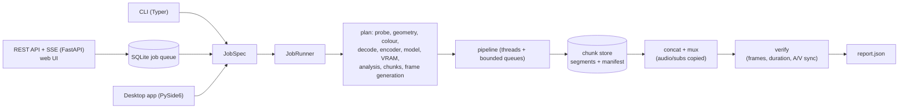
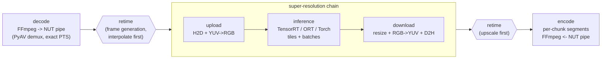

# NeuralFrame architecture

This document explains how a job flows through NeuralFrame, why the pieces are shaped the way they are,
and what each design choice costs. Measured numbers referenced here come from `docs/BENCHMARKS.md` and
the milestone findings in `docs/PLAN.md`.

## 1. One job layer, three front ends

Every front end builds the same `JobSpec` and runs the same `JobRunner`
(`neuralframe/core/job.py`); progress reaches them through one callback (`ProgressEvent`). The CLI prints
a Rich progress bar, the service persists events in SQLite and streams them over Server-Sent Events,
the GUI posts them to the Qt thread. A job is therefore exactly as fast and as correct no matter where it
was started (the reference job runs at the same fps from all three).

## 2. The pipeline

* **Stages are threads connected by bounded queues** (`core/runtime.py`). Queue sizes come from a RAM
  budget (25 % of available memory, at most 4 GB, configurable), so memory use is constant regardless of
  video length. Heavy work never holds the GIL: FFmpeg runs in subprocesses, colour/resize run in the C++
  module or in PyTorch, inference runs in TensorRT/ORT/PyTorch, all of which release it.
* **Every stage reports frames, wall fps and busy fps** (`StageMetrics`); the stage with the lowest busy
  fps is the bottleneck in the report. This is how the CUDA-stream split, the banded resize and the VRAM
  fixes were found and measured.
* **Three execution modes for the SR chain.** *Host mode* (CPU / classical models): preprocess,
  inference and postprocess stages with NumPy or native ops. *Device mode*: one stage that keeps frames on
  the GPU. *CUDA-stream mode* (default on NVIDIA): upload, inference and download each own a CUDA stream
  and pinned staging buffers (a native ring buffer registered with `cudaHostRegister`), so transfers,
  colour conversion and inference overlap.
* **Multi-GPU** runs one SR chain per GPU pulling from the shared decode queue; the encoder reorders by
  frame index, and an in-flight limiter bounds how far workers may run ahead (reorder memory stays bounded).
* **Cancellation** is a token checked by every stage; queues drain, finished chunks stay committed and the
  job is resumable.

## 3. Video I/O

* **FFmpeg subprocesses, NUT pipes, PyAV only for (de)muxing.** The decoder runs
  `ffmpeg ... -c:v rawvideo -f nut pipe:1`; PyAV demuxes the pipe, so each raw frame carries its exact PTS
  (VFR works without assuming a frame rate). The encoder is the mirror image. Whatever codecs the system
  FFmpeg has (NVENC/AMF/QSV/VAAPI/VideoToolbox, x264/x265/SVT-AV1) are usable, and codec work runs in
  other processes. *Trade-off:* one memcpy per frame through the pipe, negligible next to inference.
* **Hardware selection is detected, never assumed** (`io/hwcaps.py`): functional probes of every
  encoder/decoder are cached; a 2-frame preflight at the real size runs before a job (encoders that pass a
  320x240 probe can still fail at 4K); a decoder that fails mid-stream falls back to software decoding at
  the exact next frame.
* **Segments keep absolute timestamps** (`-copyts`, MP4 segments) so concatenation is a packet copy; the
  final mux stream-copies audio (bit-exact), subtitles (converted only when the container needs it) and
  chapters, then verification checks frame count, duration and A/V offset to within one frame.

## 4. Colour

Colour conversion is done once, by NeuralFrame, not by swscale: the decoder emits native planar YUV,
our ops convert YUV->RGB with the right matrix, range and chroma siting, optionally convert primaries in
linear light (SD SMPTE-C/EBU -> BT.709 for HD output), and convert back on output. Tags are written on the
frames (`setparams`) and as matching encoder options: if the two disagree FFmpeg silently inserts its own
conversion (measured: full-range FFV1 squeezed to limited range). HDR (PQ/HLG) is passed through with
10-bit output; the models are trained on SDR, which the report notes.

## 5. Ops: one op, three implementations

Every hot-path op (YUV<->RGB, Lanczos/bicubic resize, tile feather-merge, temporal blend) exists as a
NumPy reference (`ops/reference.py`, ground truth), C++ (`native/`, multi-threaded, GIL released,
FP contraction off) and PyTorch (`ops/torch_ops.py`, the GPU path). Native output is **bit-identical** to
the reference (19-34x faster); weights and transfer curves are built with scalar math into cached tables
because NumPy's SIMD transcendental functions differ by an ULP between runs. GPU resize uses banded
block matrix multiplies (4.8x faster than dense matrices with identical output).

## 6. Inference

* **Backends behind one interface** (`inference/backend.py`): PyTorch (reference), ONNX Runtime (CUDA /
  TensorRT / DirectML / ROCm / CPU execution providers) and TensorRT (FP16 engines with optimisation
  profiles). `auto` picks TensorRT on NVIDIA, ONNX Runtime elsewhere, PyTorch as the fallback.
  TensorRT is 1.3-2.6x faster than PyTorch eager FP16 on the measured models, matching it at 58-70 dB.
* **Engine cache key**: model hash, GPU name, compute capability, driver, TensorRT version, precision and
  shape profile; stale engines are pruned automatically and a timing cache speeds up rebuilds.
* **Fixed-size tiles** (`chunking/tiling.py`): edge tiles shift inward instead of shrinking, so every
  batch has one shape and TensorRT needs one profile. Tiles overlap and are merged with feathered weights
  that discard the margin; tiled vs whole-frame output differs by > 57 dB PSNR.
* **Model building** (`inference/archs/`): the Real-ESRGAN family, RealBasicVSR and RIFE are built from
  the project's own module definitions; the transformer models (HAT, DRCT, DAT, ATD, SwinIR), BSRGAN,
  RealPLKSR and any model a user adds are built by spandrel from the checkpoint. Those are PyTorch-only
  (`backends: [torch]` in the registry); models that overflow in FP16 (`fp16: false`) run in BF16 where the
  GPU supports it natively and FP32 otherwise. A planning estimate of activation memory per input pixel
  (`memory_per_pixel`) sizes their tiles before the VRAM calibration refines it.
* **Automatic model choice** (`models/advisor.py`): eight frames spread over the input are measured on
  the CPU - noise (Immerkaer's estimator on the flatter half of the frame), 8x8 blocking (strongest grid
  phase vs the median of all eight, so crops do not hide it), bits per pixel against a per-codec
  threshold, real detail (the strongest downscale whose re-upscale only loses noise) and cartoon look
  (hard vs soft edge ratio and flat-area share on a thumbnail). Each single-frame model is scored from its
  `rank`, `content`, `handles`, `speed`, `stills` and scale; the job report records the measurements, the
  choice and the reasons. Analysis errors never stop a job: the general fast model is used instead.

## 7. VRAM strategy

1. **Plan** tile and batch from free memory and a per-model bytes-per-pixel estimate, after reserving
   what frame interpolation will need on the same GPU.
2. **Calibrate**: one dry run with synthetic frames; shrink until the safety margin (default 15 %) stays
   free. Calibrated settings are pinned in the chunk manifest so resumed chunks are bit-identical.
3. **Recover**: on out-of-memory the ladder halves the batch, then the tile (at most three levels), then
   falls back TensorRT -> PyTorch -> CPU, without losing finished chunks.
4. **Cap PyTorch's cache** during the run. Stages on separate CUDA streams cannot reuse each other's
   cached blocks; uncapped, the cache grew to fill the 8 GB card and Windows spilled into shared memory
   (2x slower). The cap is the free memory at pipeline start minus the margin.

*Trade-off:* calibration costs a fraction of a second per job and the cap triggers occasional cache
flushes (measured ~90 per job), both far cheaper than an overcommitted GPU.

## 8. Chunks and resume

* An **analysis pass** decodes 64x36 thumbnails through the same filter chain: timestamps, motion and a
  histogram scene score (cached per input). Chunks (default 240 frames) are aligned to nearby scene cuts.
* Each chunk is encoded into its own segment and committed to a **chunk store** with a manifest (frame
  count, PTS range, SHA256). Resume verifies segments, then either seeks to just before the last
  committed frame (single-frame models, no stateful filters) or decodes and skips by exact PTS.
* Kill-and-resume produces identical frame checksums (tested for lossless CPU encodes, NVENC,
  multi-worker runs, temporal models and frame generation).

## 9. Temporal models

RealBasicVSR sees a whole chunk plus `overlap` frames on each side. Overlap regions of neighbouring chunks
are cross-faded with linear weights, except across scene cuts, where no blending happens. A resumed job
re-runs the last finished chunk without emitting it, to rebuild the shared blend zone. SPyNet stays in FP32
(49.8 dB vs 44.7 dB all-FP16 against an FP32 reference) and the 4x head runs in strips to bound memory.

## 10. Frame generation

1. **Drop detection** on the analysis data: timestamp gaps (> 1.5x the median interval), and frozen
   frames: near-zero difference while the neighbourhood moves. Regular holds (animation on twos) are a
   cadence, not drops, and are kept in `auto` mode.
2. **Retime plan** onto a constant-rate grid (default 60 fps, 59.94 for NTSC sources): each output frame
   is an exact copy, an interpolation between its two surrounding unique source frames at time `t`, or the
   nearest frame (across scene cuts and gaps longer than 0.5 s, where morphing would ghost).
3. **RIFE 4.22** synthesises all timesteps of a source pair in VRAM-sized batches; copies pass through
   bit-exact. FFmpeg `minterpolate` is the model-free fallback.
4. **Order**: interpolating first costs one more SR pass per synthesised frame and saves
   RIFE(output size) - RIFE(source size); `auto` interpolates first for classical and compact models
   (3.3x / 1.4x faster measured) and upscales first for heavy RRDBNet models.

## 11. Service and desktop app

* **Job store** (`db/store.py`): SQLite in WAL mode via SQLAlchemy 2.0; priority then FIFO; atomic claims;
  jobs that were running when the server stopped are re-queued with `resume` on the next start.
* **Manager** (`api/manager.py`): one worker per GPU (one active job per GPU), live progress in memory for
  SSE, persisted at most once a second per job.
* **API** (`api/app.py`): every path is resolved (symlinks, `..`) and must lie inside the configured roots;
  binds to 127.0.0.1 by default; no authentication (documented).
* **GUI** (`gui/`): the job and all slow work run in Python threads; results return through a dispatcher
  QObject with a queued connection, so widgets are only touched on the GUI thread.

## 12. Observability

Structured logs (structlog, JSON optional) carry `job_id`/`chunk_id`; errors use a fixed taxonomy
(`PROBE_FAILED`, `DECODE_FAILED`, `ENGINE_BUILD_FAILED`, `OOM_UNRECOVERABLE`, `ENCODE_FAILED`,
`MUX_FAILED`, `SYNC_CHECK_FAILED`, ...) with a hint for the user. Every job writes a report next to its
output: plan and notes, timings, per-stage throughput and bottleneck, VRAM calibration and adaptations,
frame generation statistics, GPU utilisation, peak VRAM and the sync verification.
