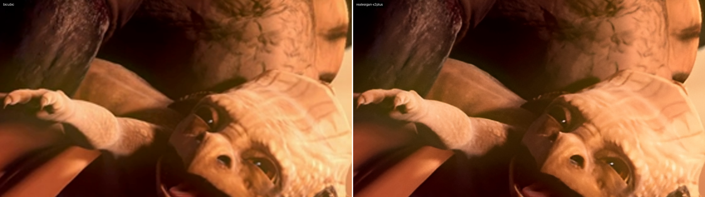

# Before / after gallery

Crops from the quality evaluation (`benchmarks/quality.py`), shown at 2x so individual pixels are
visible. Left: the low-resolution input scaled up with bicubic interpolation (what a normal player
shows). Right: NeuralFrame. The last image of each set is the original high-resolution frame for
reference. Metrics for the whole 6-second segment are in [BENCHMARKS.md](BENCHMARKS.md#quality).

Footage: *Sintel* trailer, (c) Blender Foundation | durian.blender.org, licensed CC BY 3.0. The
1920x816 picture (letterbox removed) was downscaled with bicubic filtering to make the inputs.

## 4x upscale, clean input (480x204 -> 1920x816)

**Real-ESRGAN x4plus** - general-purpose: sharper edges and texture on the dragon's face and wing.


**Real-ESRGAN AnimeVideo v3** - fast compact model: clean lines, flatter texture (best LPIPS here).


**RealBasicVSR** (temporal) - strongest sharpening and invented line texture: highest VMAF, but a
painted look on this soft CG footage (worst LPIPS).


Original frame:


## 4x upscale, compressed input (x264 CRF 28)

The case these models are trained for: blocking and ringing from compression are removed rather than
enlarged.


## 2x upscale, clean input (960x408 -> 1920x816)

**Real-ESRGAN x2plus**: on clean input it smooths fine texture slightly (it is trained to remove heavy
degradations); Lanczos scores marginally higher here.




## Reproduce

```bash
python benchmarks/quality.py   # downloads the trailer once (SHA256-checked), writes results and these crops
neuralframe compare input.mp4 output.mkv --frame 120 --crop 840,120,560,315 --zoom 2
```
